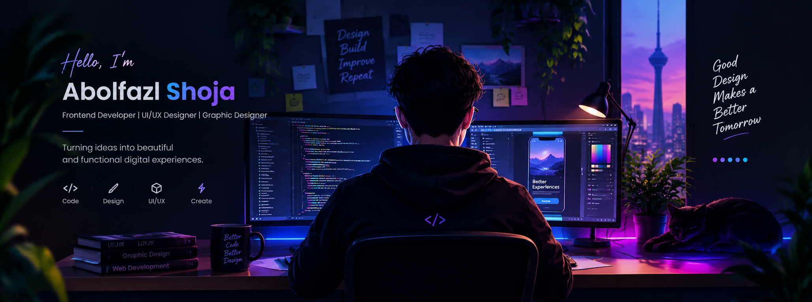

# Hi, I'm Abolfazl Shoja

  

  <strong>Founder @ ByteNest | Front-End & UI/UX Developer</strong>

  Building secure, accessible, and user-friendly web experiences through software engineering, visual design, and security-focused development.

---

## 👨‍💻 About Me

I'm a web designer and developer with a background in Electronics, Graphic Design, and Web Technology. My coding journey began in 2019, combining self-directed learning with academic education.

My multidisciplinary background helps me bring together technical logic, visual design, and software engineering to create practical, intuitive, and secure digital experiences.

I work with PHP-based applications, content management systems, front-end technologies, and web security practices. I also use AI-assisted development tools while personally reviewing code quality, implementation, and security.

---

## 🛠️ Tech Stack

### Languages & Web Technologies

  

### Frameworks & Libraries

  

### Databases

  

### CMS & Platforms

  
  

### Web Server

  

---

## 💡 What I Do

- **Web Development** — Building custom PHP systems and web applications from scratch.
- **Application Security** — Applying OWASP security principles and secure development practices.
- **CMS Development** — Working with WordPress, Drupal, and MyBB.
- **Front-End Development** — Creating responsive interfaces with HTML, CSS, JavaScript, and related technologies.
- **UI/UX Design** — Designing clean, accessible, and intuitive user experiences.
- **AI-Assisted Development** — Using AI tools to accelerate development while personally reviewing code quality and security.

---

## 🚀 Featured Projects

### 🛡️ BNG Protection Scanner

A modular, read-only PHP security scanner designed to identify suspicious code patterns, potentially exposed sensitive files, and insecure configurations.

  

### 🌐 PHP HTTP Custom Error Pages

A lightweight, framework-independent PHP and Apache solution featuring clean, responsive HTTP error pages for common status codes, including 403, 404, 500, and 503.

  

---

## 📫 Connect With Me

  
  

---

  <strong>ByteNest Group | Beyond Digital</strong>
   
  Design with purpose. Develop with precision. Build with security in mind.

